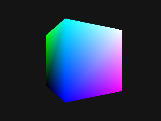

# J5 · Rasterizador por software (S2, bloque 2.5)

`raster.cpp` (≈ 120 líneas) recorre el **pipeline gráfico completo en CPU**:
- matrices de modelo, vista y proyección;
- división por *w* y *viewport*;
- rasterización por **funciones de arista**, con regla *top-left* y eliminación de caras traseras;
- interpolación baricéntrica de color y **z-buffer**.

Escribe una imagen PPM y su *hash* FNV-1a, que sirve como **test de imagen de referencia**.

```text
g++ -std=c++20 -O2 raster.cpp -o raster && ./raster cube.ppm 30
```



## Comprobado el 15-oct-2026

| Compilador | Ángulo | Píxeles cubiertos | *Hash* |
|---|---|---|---|
| g++ 16.1 (MinGW, Windows), `-O2`, sin avisos con `-Wall -Wextra -Wconversion` | 30° | 21.456 | `faf1697bf5f869dd` |
| clang 22.1.6 (Windows), `-O2` | 30° | 21.456 | `faf1697bf5f869dd` |
| g++, dos ejecuciones | 30° | 21.456 | idéntico |
| g++ | 0° | 21.305 | `6311e453c2715016` |

## Qué tiene que añadir el estudiante (J5)

1. **Interpolación corregida por perspectiva**: ahora es afín, y el error se nota en caras muy inclinadas. Es la diferencia clásica que explica la teoría de 2.5.2.
2. **Mallas del kit:** cargar un OBJ sencillo en lugar del cubo.
3. **Test de imagen de referencia en la CI**, con tolerancia por píxel en lugar de *hash* exacto si se usan otros compiladores o `-march=native`.
4. **Cifra:** triángulos por segundo y tiempo por fotograma, comparados con la GPU en 3.2.
